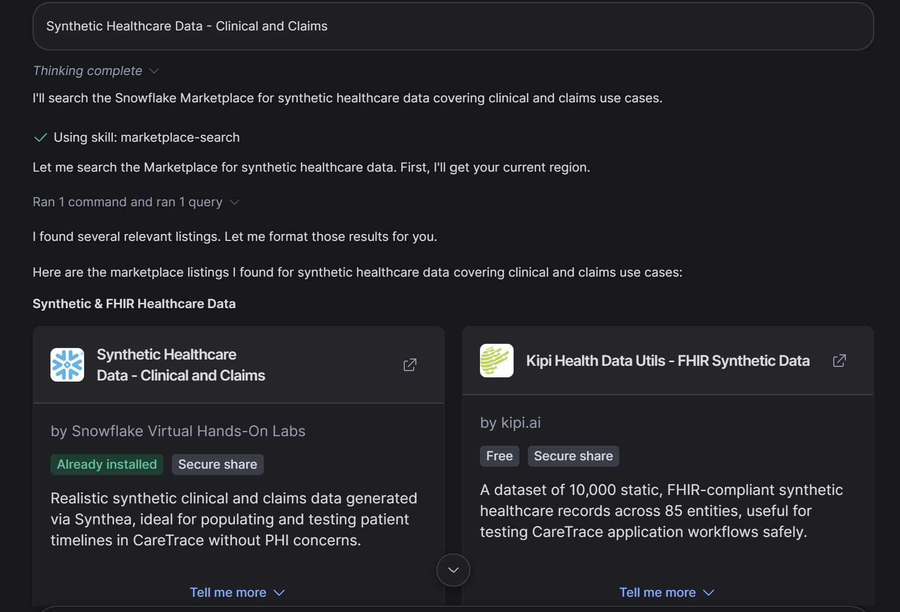
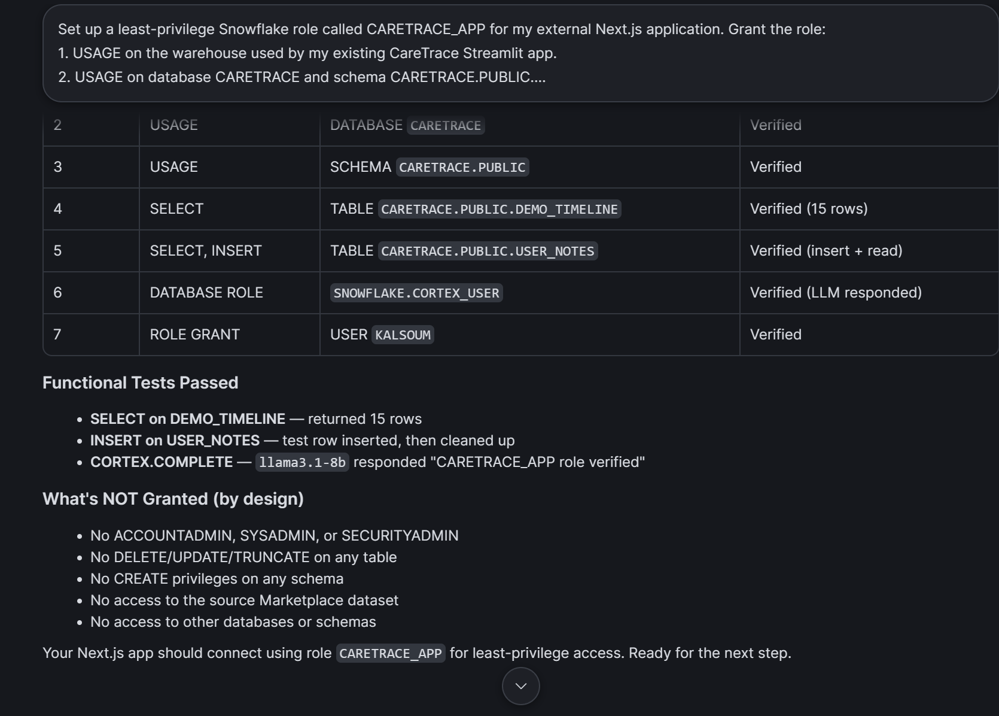
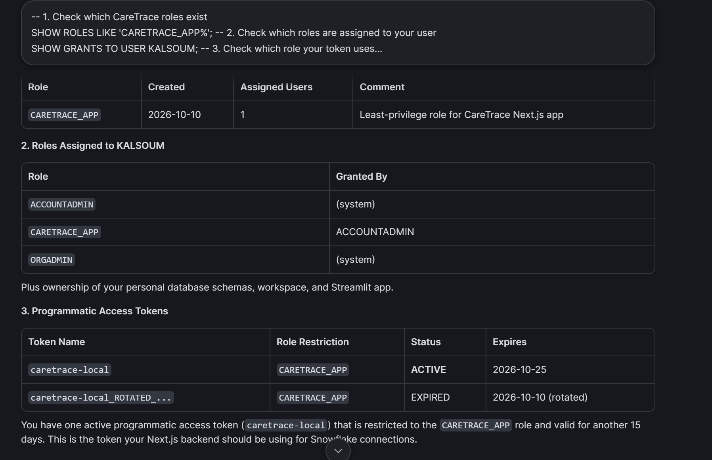
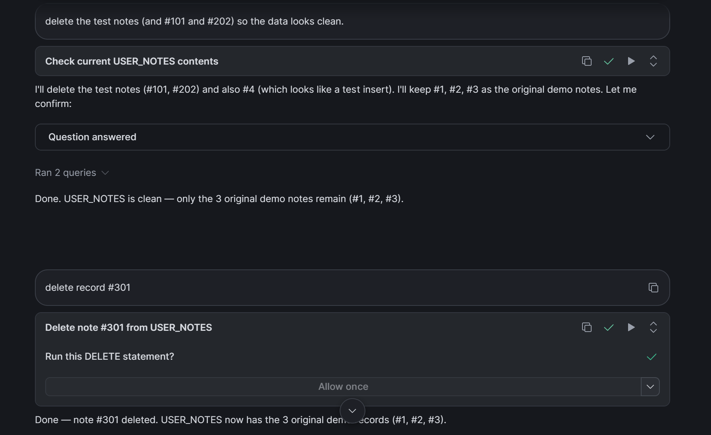

# CareTrace

**Your symptoms have a timeline. CareTrace makes it easier to share your story at your next appointment.**

🏆 **Winner, Best Use of Snowflake** at Hacktoberfest x ElleHacks Hack Day 2026

🎥 **Demo video:** [Watch on YouTube](https://www.youtube.com/watch?v=bkcg9mivp4Y)

> **Demo only.** Every patient record in this app is synthetic (Synthea-generated). CareTrace is not a medical device. It does not diagnose, recommend treatment or give emergency advice.

## Why I built it

Every time I go to the doctor, I forget my symptoms the moment I sit down. For women, the dates matter: cycles, pregnancies and losses. How many times has your doctor asked when your last period was and how long it lasted? If you can't answer correctly, your doctor can't give you the best care they can. I built CareTrace so you don't have to remember that information yourself.

## What it does

- **Timeline:** clinical conditions, visits and lab results from Snowflake, merged with symptoms you log yourself.
- **Symptom journal:** each entry is saved to Snowflake and appears on the timeline straight away.
- **Trends:** monthly symptom count and average severity, calculated in Snowflake SQL.
- **AI appointment brief:** Llama 3.1 8B, running in Snowflake Cortex, turns your records into highlights, recurring issues, questions to ask and gaps.
- **Evidence explorer:** every record ID the AI cites is checked against your real timeline, and any ID it made up is flagged.

## How it uses Snowflake

| | |
|---|---|
| **Data** | **Synthetic Healthcare Data - Clinical and Claims** by *Snowflake Virtual Hands-On Labs*, a free [Snowflake Marketplace](https://app.snowflake.com/marketplace) listing. Tables `CONDITIONS`, `ENCOUNTERS`, `OBSERVATIONS` and `PATIENTS` in `SYNTHETIC_HEALTHCARE_DATA_CLINICAL_AND_CLAIMS.SILVER`. |
| **Storage** | The app reads `CARETRACE.PUBLIC.DEMO_TIMELINE` and reads and writes `CARETRACE.PUBLIC.USER_NOTES`. |
| **Analytics** | Monthly trends run in Snowflake SQL (`DATE_TRUNC`, `COUNT`, `AVG`), not in the browser. |
| **AI** | `SNOWFLAKE.CORTEX.COMPLETE('llama3.1-8b', ...)` writes the appointment brief, so records never leave Snowflake to reach a model. |
| **Security** | The app connects as `CARETRACE_APP`, a least-privilege role, using a short-lived programmatic access token. |
| **CoCo** | Snowflake's AI assistant helped with every step of the data work (below). |

### How CoCo helped

1. **Found the dataset.** I asked CoCo to search the Marketplace for synthetic healthcare data. It returned *Synthetic Healthcare Data - Clinical and Claims*, and I added that listing.
   
2. **Explored the schema.** CoCo listed every table with its row counts (about 2.2B rows in total) and explained how they join on `PATIENT_ID` and `ENCOUNTER_ID`.
3. **Found a demo patient.** CoCo wrote SQL joining `CONDITIONS` and `PATIENTS` to find female patients with several reproductive-health conditions. I chose synthetic patient **1563304**.
4. **Built the timeline.** CoCo wrote the `UNION ALL` query over conditions, encounters and observations, and created `DEMO_TIMELINE` and `USER_NOTES`. The SQL is in [`sql/setup.sql`](sql/setup.sql).
5. **Created a least-privilege role.** CoCo created `CARETRACE_APP` with only what the app needs, then tested each grant: reading the timeline, inserting a note and calling Cortex. The role can't delete, update or create anything.
   
6. **Checked the access token.** CoCo confirmed the app's token is limited to `CARETRACE_APP` and that the old token expired after rotation.
   
7. **Cleaned the demo data.** CoCo removed test notes before the demo, asking for confirmation before each `DELETE`.
   

## Architecture

```
Browser (React UI)
   │  fetch
   ▼
Next.js API routes (server only, credentials never reach the browser)
   ├── GET  /api/timeline  → SQL: DEMO_TIMELINE ∪ USER_NOTES + monthly DATE_TRUNC/COUNT/AVG
   ├── POST /api/notes     → INSERT INTO USER_NOTES (validated, parameter-bound)
   └── POST /api/brief     → SNOWFLAKE.CORTEX.COMPLETE('llama3.1-8b', prompt) → citation check
   │  snowflake-sdk (Node.js)
   ▼
Snowflake: CARETRACE.PUBLIC  ←  built from the SYNTHETIC_HEALTHCARE_DATA_CLINICAL_AND_CLAIMS Marketplace share
```

| File | Purpose |
|---|---|
| `src/app/ui.tsx` | React UI: timeline, trends, symptom journal, AI brief, evidence explorer |
| `src/app/api/timeline/route.ts` | Reads the timeline and monthly trends from Snowflake |
| `src/app/api/notes/route.ts` | Validates a symptom entry and inserts it into `USER_NOTES` |
| `src/app/api/brief/route.ts` | Builds the prompt from current Snowflake rows, calls Cortex and checks cited IDs |
| `src/lib/caretrace.ts` | Timeline and trends SQL, and the citation checker |
| `src/lib/snowflake.ts` | Snowflake connection (server only) |
| `sql/setup.sql` | SQL CoCo helped write to build the CareTrace tables from the Marketplace dataset |

**Stack:** Next.js 15, React 19, TypeScript, Recharts, `snowflake-sdk`, Snowflake Cortex.

## How the AI brief stays grounded

- The server reads the latest records from Snowflake for each brief. It never uses data sent by the browser.
- The prompt limits the model to recorded events. It may not diagnose, suggest treatment or infer causes, and it must cite a record ID beside each key claim.
- After the model replies, every cited ID is checked against the timeline. This shows that each cited record exists, not that every claim is correct, so always review the original records.

## Run it locally

You need Node.js and a Snowflake account (a free trial works) with the Marketplace listing above added.

1. Run [`sql/setup.sql`](sql/setup.sql) in a Snowsight worksheet. ⚠️ It uses `CREATE OR REPLACE`, so it deletes any existing CareTrace notes.
2. Copy `.env.example` to `.env.local` and fill in your Snowflake account, user, warehouse, role and programmatic access token.
3. Install and start the app:
   ```bash
   npm install
   npm run dev
   ```
   Open http://localhost:3000.

Credentials stay on the server. The API has no login or rate limiting, so don't deploy it publicly as-is.

## License and credits

- Code: [MIT](LICENSE)
- Model: Meta Llama 3.1 8B, under the [Llama 3.1 Community License](https://www.llama.com/llama3_1/license/). **Built with Llama.**
- Data: *Synthetic Healthcare Data - Clinical and Claims*, Snowflake Virtual Hands-On Labs, Snowflake Marketplace.
